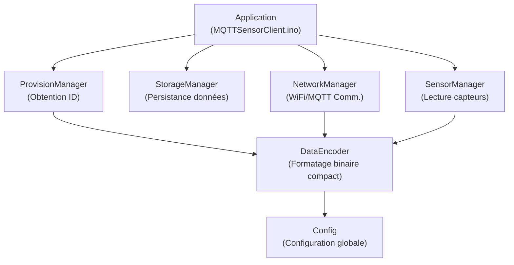
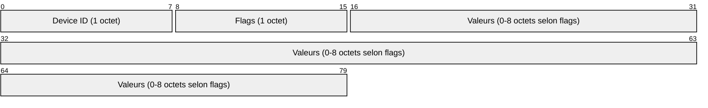
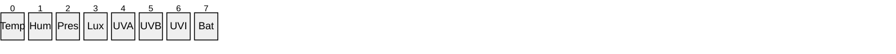
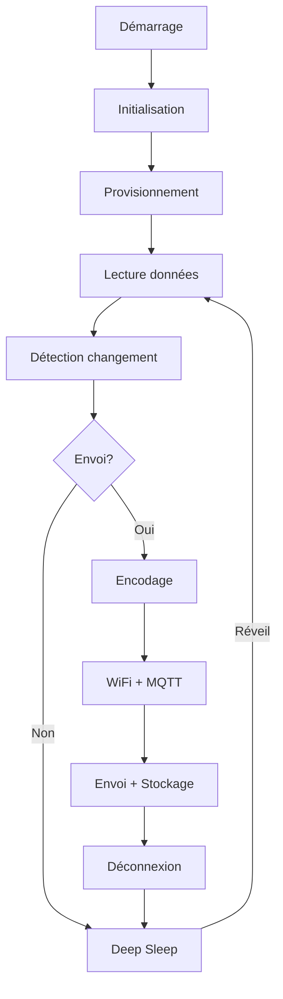
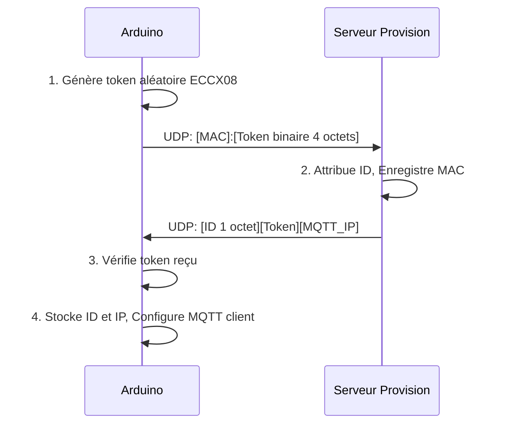
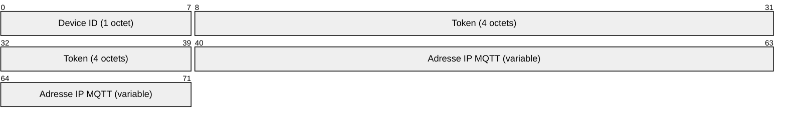

# Station Météo IoT MKR ENV - Documentation

Cette documentation détaille l'implémentation d'une station météo IoT basée sur Arduino MKR avec économie d'énergie et provisionnement automatique.

## Table des matières

- [Architecture logicielle](#architecture-logicielle)
- [Modules](#modules)
  - [Config](#module-config)
  - [SensorManager](#module-sensormanager)
  - [NetworkManager](#module-networkmanager)
  - [DataEncoder](#module-dataencoder)
  - [StorageManager](#module-storagemanager)
  - [ProvisionManager](#module-provisionmanager)
- [Structures de données](#structures-de-données)
- [Format des messages](#format-des-messages)
- [Flux d'exécution](#flux-dexécution)
- [Optimisations](#optimisations)
- [Configuration](#configuration)
- [Provisionnement](#provisionnement)
- [Protocole de communication](#protocole-de-communication)
- [Guide d'utilisation](#guide-dutilisation)

## Architecture logicielle

Le projet est conçu selon une architecture modulaire qui sépare les différentes responsabilités du système :



Cette architecture permet :

- Une meilleure organisation du code
- Une séparation claire des responsabilités
- Une maintenance facilitée
- Une réutilisabilité des composants
- Des tests unitaires plus simples

## Modules

### Module Config

Ce module centralise toutes les constantes et configurations du système.

**Fichier :** `Config.h`

**Responsabilités :**

- Paramètres WiFi et MQTT
- Configuration du provisionnement
- Seuils de détection de changements
- Intervalles de temps
- Macros de débogage

**Points notables :**

- L'utilisation de macros pour le débogage permet d'éliminer tout surcoût en production
- La centralisation des configurations facilite l'adaptation à différents environnements

### Module SensorManager

Ce module gère l'interaction avec les capteurs physiques.

**Fichiers :** `SensorManager.h`, `SensorManager.cpp`

**Responsabilités :**

- Initialisation du shield ENV
- Lecture des valeurs des capteurs
- Détection des changements significatifs
- Regroupement des lectures en structure

**Structure principale :**

```cpp
struct SensorReadings {
  float temperature;
  float humidity;
  float pressure;
  float illuminance;
  float uva;
  float uvb;
  float uvindex;
  float battery;
};
```

**Méthodes clés :**

```cpp
bool begin();             // Initialisation des capteurs
SensorReadings readAll(); // Lecture de tous les capteurs
```

> **Note :** La détection des changements significatifs est gérée par le module `DataEncoder` via la méthode `detectChanges()`.

### Module NetworkManager

Ce module gère les communications réseau WiFi et MQTT.

**Fichiers :** `NetworkManager.h`, `NetworkManager.cpp`

**Responsabilités :**

- Connexion au réseau WiFi
- Connexion au broker MQTT avec ID provisionné
- Envoi des messages MQTT
- Déconnexion propre des services

**Méthodes clés :**

```cpp
bool connectWiFi();
bool connectMQTT(const char* brokerIP, uint8_t deviceId);
bool sendMessage(const char* topic, const uint8_t* buffer, size_t length);
void disconnect();
```

**Points notables :**

- Gestion des timeouts pour éviter les blocages
- Support de l'authentification MQTT (facultatif)
- Création d'un ID client basé sur l'identifiant unique provisionné

### Module DataEncoder

Ce module gère le format binaire compact des données transmises.

**Fichiers :** `DataEncoder.h`, `DataEncoder.cpp`

**Responsabilités :**

- Détection des changements de valeurs
- Encodage compact des données en binaire
- Génération des topics MQTT basés sur l'ID

**Structures de données :**

```cpp
struct ChangedFlags {
  bool temperature;
  bool humidity;
  bool pressure;
  bool illuminance;
  bool uva;
  bool uvb;
  bool uvindex;
  bool battery;
};
```

**Méthodes clés :**

```cpp
size_t encodeSensorData(...);
ChangedFlags detectChanges(...);
void generateTopic(char* topicBuffer, size_t bufferSize, uint8_t deviceId);
```

### Module StorageManager

Ce module gère la persistance des données entre les cycles de sommeil profond.

**Fichiers :** `StorageManager.h`, `StorageManager.cpp`

**Responsabilités :**

- Sauvegarde des dernières lectures validées
- Chargement des données au démarrage
- Persistance de l'état de transmission

**Structure principale :**

```cpp
typedef struct {
  SensorManager::SensorReadings lastReadings;
  bool forceSendAll;
  unsigned long lastSendTime;
  bool valid;
} StoredData;
```

**Méthodes clés :**

```cpp
void saveData(...);
StoredData loadData();
bool isDataValid();
```

### Module ProvisionManager

Ce module gère l'attribution d'un identifiant unique et la découverte du broker MQTT.

**Fichiers :** `ProvisionManager.h`, `ProvisionManager.cpp`

**Responsabilités :**

- Génération sécurisée de token aléatoire avec ECCX08
- Communication UDP avec le serveur de provisionnement
- Récupération de l'ID d'appareil unique
- Récupération de l'adresse du broker MQTT
- Retentatives et gestion des timeouts

**Méthodes clés :**

```cpp
bool begin();
bool requestID();
bool isProvisioned();
uint8_t getDeviceID();
const char* getMQTTBroker();
void update();
void printStatus();  // Affiche l'état du provisionnement (debug)
```

## Structures de données

### SensorReadings

Structure contenant l'ensemble des valeurs des capteurs.

```cpp
struct SensorReadings {
  float temperature;    // Température en °C
  float humidity;       // Humidité en %
  float pressure;       // Pression en kPa
  float illuminance;    // Luminosité en lux
  float uva;            // Rayonnement UVA (sans unité)
  float uvb;            // Rayonnement UVB (sans unité)
  float uvindex;        // Indice UV (sans unité)
  float battery;        // Tension batterie en V
};
```

### ChangedFlags

Structure indiquant quelles valeurs ont changé significativement.

```cpp
struct ChangedFlags {
  bool temperature;
  bool humidity;
  bool pressure;
  bool illuminance;
  bool uva;
  bool uvb;
  bool uvindex;
  bool battery;
};
```

### StoredData

Structure persistante stockée en mémoire flash.

```cpp
typedef struct {
  SensorManager::SensorReadings lastReadings;  // Dernières lectures envoyées
  bool forceSendAll;                           // Forcer envoi complet au prochain cycle
  unsigned long lastSendTime;                  // Horodatage du dernier envoi
  bool valid;                                  // Indicateur de validité des données
} StoredData;
```

## Format des messages

Le format des messages a été optimisé pour minimiser la quantité de données transmises. Une technique d'encodage binaire avec bitmap de présence est utilisée.

### Structure du message binaire



### Octet de flags

Chaque bit de l'octet de flags indique si une valeur est présente dans le message :



### Encodage des valeurs

Chaque valeur est encodée sur un seul octet pour maximiser l'efficacité :

| Valeur      | Encodage                                                      | Plage couverte   |
|-------------|---------------------------------------------------------------|------------------|
| Température | `Valeur * 10` ou `256 + (Valeur * 10)` pour valeurs négatives | -25.5 à +25.5 °C |
| Humidité    | `Valeur` directe                                              | 0 à 100 %        |
| Pression    | `(Valeur - 90) * 10`                                          | 90 à 115.5 kPa   |
| Luminosité  | `Valeur / 10`                                                 | 0 à 2550 lux     |
| UVA         | `Valeur` directe                                              | 0 à 255          |
| UVB         | `Valeur` directe                                              | 0 à 255          |
| UV Index    | `Valeur * 100`                                                | 0 à 2.55         |
| Batterie    | `(Valeur - 2) * 100`                                          | 2 à 4.55 V       |

Cette approche permet de réduire considérablement la taille des messages (jusqu'à 97% par rapport à JSON) tout en maintenant une précision suffisante.

## Flux d'exécution

Le flux d'exécution du système est optimisé pour minimiser la consommation d'énergie tout en assurant la fiabilité des données :



### Particularités du flux

1. **Mode Deep Sleep**
   - L'Arduino est en sommeil profond la majorité du temps
   - Consommation réduite à <100μA en sommeil
   - Activation périodique pour les mesures et transmissions

2. **Logique conditionnelle**
   - Transmission uniquement si changements significatifs
   - Forçage périodique pour garantir des mises à jour
   - Reconnexion uniquement en cas de besoin

3. **Provisionnement dynamique**
   - Obtention d'un ID unique au démarrage
   - Mise à jour périodique si non provisionné
   - Construction dynamique des topics MQTT

## Optimisations

Plusieurs optimisations ont été implémentées pour maximiser l'efficacité énergétique et la fiabilité :

### Optimisations énergétiques

1. **Deep Sleep**
   - Utilisation de `LowPower.deepSleep()` au lieu de `delay()`
   - Réduction drastique de la consommation

2. **Connexion conditionnelle**
   - WiFi activé uniquement lorsque nécessaire
   - Déconnexion complète après transmission

3. **Transmission sélective**
   - Envoi uniquement des valeurs qui ont changé significativement
   - Réduction du temps d'émission radio

### Optimisations de bande passante

1. **Format binaire compact**
   - Encodage optimisé sur 1 octet par valeur
   - Utilisation d'un bitmap de présence

2. **Transmission différentielle**
   - Envoi uniquement des valeurs qui ont changé
   - Réduction du volume de données de 60-95%

### Optimisations de fiabilité

1. **Persistance des données**
   - Sauvegarde en mémoire flash des dernières valeurs
   - Restauration de l'état après redémarrage

2. **Gestion des erreurs**
   - Timeouts sur toutes les opérations réseau
   - Retentatives avec intervalles progressifs

3. **Provisionnement sécurisé**
   - Utilisation de tokens aléatoires générés par matériel
   - Vérification des réponses du serveur

## Configuration

La configuration du système se fait principalement dans le fichier `Config.h`. Voici les principaux paramètres :

### Paramètres réseau

```cpp
#define WIFI_SSID "votre_ssid"
#define WIFI_PASSWORD "votre_mot_de_passe"
```

### Paramètres de provisionnement

```cpp
#define PROVISION_SERVER_IP "192.168.1.100"
#define PROVISION_SERVER_PORT 5000
```

### Paramètres d'économie d'énergie

```cpp
#define SLEEP_TIME 300000  // Durée du deep sleep en ms (5 minutes)
```

### Seuils de détection de changements

```cpp
#define TEMP_THRESHOLD 0.5   // °C
#define HUM_THRESHOLD 2.0    // %
#define PRES_THRESHOLD 0.2   // kPa
#define LUX_THRESHOLD 10.0   // lx
#define UV_THRESHOLD 1.0     // unité
#define UVI_THRESHOLD 0.05   // indice
#define BAT_THRESHOLD 0.1    // V
```

### Intervalles de transmission

```cpp
#define MAX_NO_SEND_INTERVAL 3600000  // 1 heure
```

## Provisionnement

Le système utilise un mécanisme de provisionnement sécurisé pour obtenir un identifiant unique et l'adresse du broker MQTT.

### Processus de provisionnement



### Sécurité du provisionnement

1. **Token matériel sécurisé**
   - Génération par la puce ECCX08 dédiée à la cryptographie
   - Protection contre les attaques par rejeu

2. **Vérification bidirectionnelle**
   - Le serveur vérifie l'adresse MAC
   - L'Arduino vérifie le token retourné

3. **Retentatives limitées**
   - Maximum 5 tentatives initiales
   - Attente progressive entre les tentatives

## Protocole de communication

### MQTT

Le système utilise MQTT comme protocole de communication principal avec le serveur :

- **QoS** : 0 (at most once) pour maximiser l'efficacité énergétique
- **Topic** : `sensors/{deviceID}/compact`
- **Format** : Binaire compact (voir section Format des messages)
- **Fréquence** : Variable, basée sur les changements détectés

### Format de réponse du serveur de provisionnement



## Guide d'utilisation

### Installation

1. Configurer les paramètres dans `Config.h`
2. Compiler et téléverser le programme sur l'Arduino MKR
3. S'assurer que le serveur de provisionnement est en cours d'exécution
4. Vérifier les logs pour confirmer le provisionnement

### Débogage

Le mode débogage peut être activé en définissant `DEBUG_ENABLED` dans `Config.h`.

Les logs de débogage incluent :

- Lectures des capteurs
- État du provisionnement
- Détails de connexion WiFi/MQTT
- Détails des messages envoyés
- Erreurs et retentatives

### Maintenance

#### Remplacement de la batterie

Lors du remplacement de la batterie, l'état est préservé grâce à la persistance en mémoire flash.

#### Mise à jour du code

En cas de mise à jour du code :

1. Conserver le fichier `Config.h` avec vos paramètres
2. Recompiler et téléverser
3. Le système reprendra automatiquement avec l'ID précédemment provisionné

---

Cette documentation détaille l'implémentation complète d'une station météo IoT économe en énergie, avec provisionnement automatique et transmission optimisée des données. L'architecture modulaire permet une adaptation facile à différents besoins et environnements.
